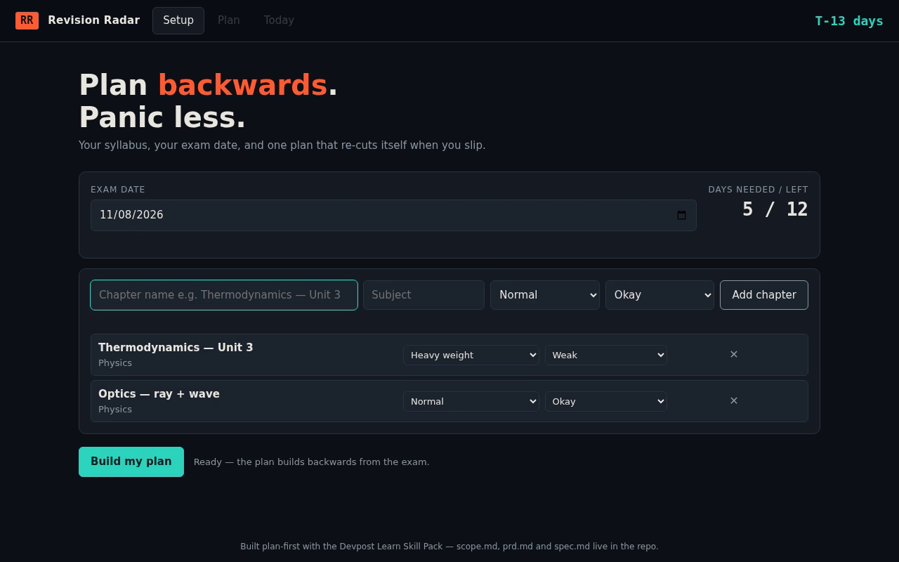
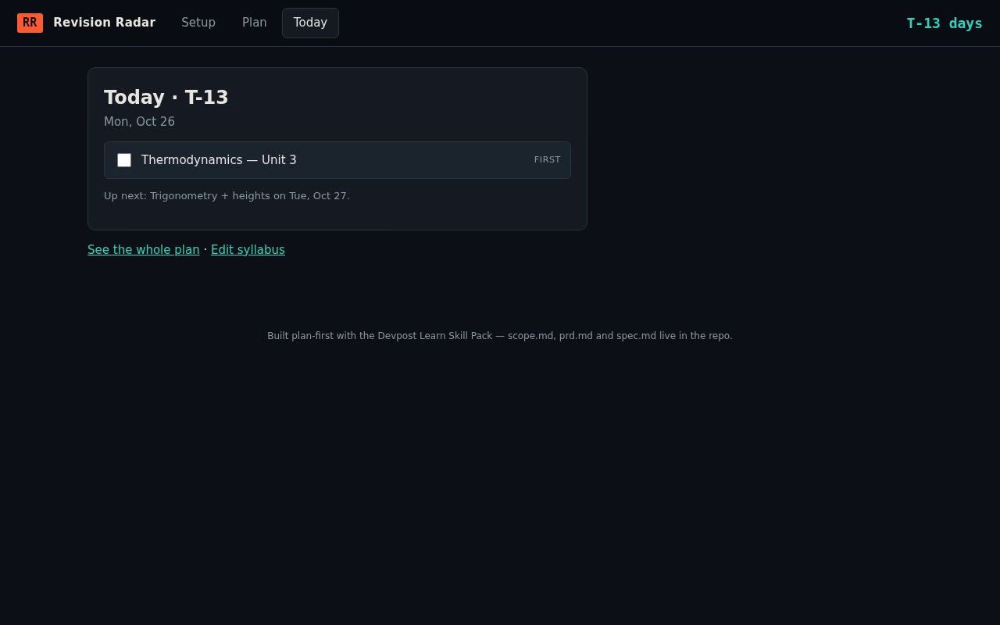
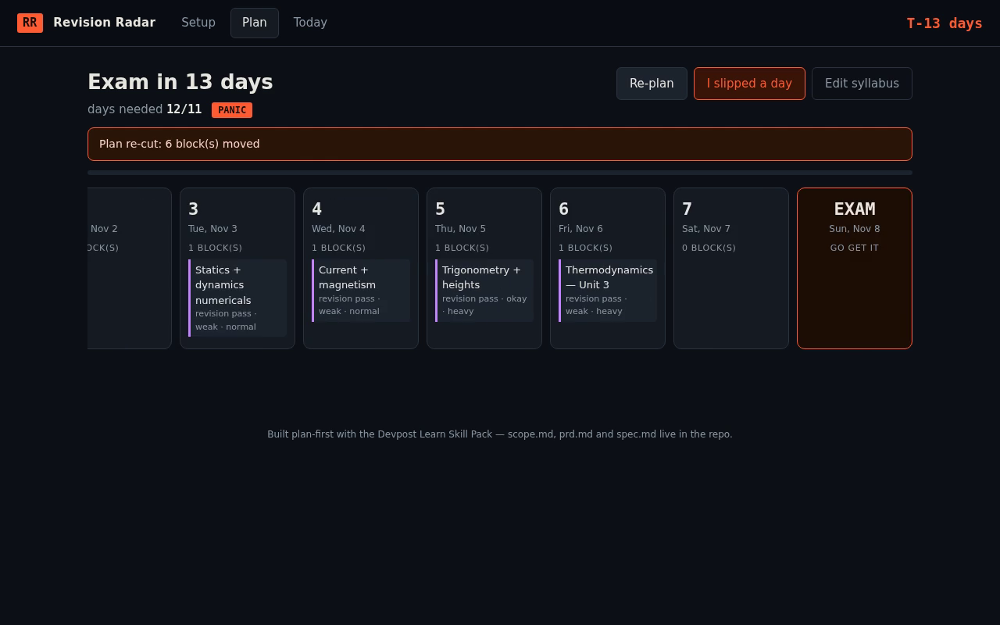

# Revision Radar

A backwards exam-revision planner. Add your syllabus chapters with a weight and a confidence, set the exam date, and the app lays out a day-by-day revision plan that counts backwards from the exam. Slip a day or discover a chapter is harder than you thought, and one Re-plan click re-sequences everything that's left, telling you exactly what got dropped.

Built for the [Build With AI: Basics](https://learn-ai-basics.devpost.com/) hackathon, plan-first with the [Devpost Learn Skill Pack](https://github.com/challengepost/learn-ai-basics): the `devpost/` folder holds the scope, PRD, spec and build checklist that were written and approved before any code.

## Try it

Open `index.html` in any modern browser, or serve the folder:

```bash
python3 -m http.server 8000
# then open http://localhost:8000
```

The planner is now a full-stack app: real accounts (email + password), and your syllabus, plan, ticks and slipped days are stored server-side per user, not in localStorage. Open the deployed site and sign in, or run it locally:

```bash
pip install -r requirements.txt
REVISION_RADAR_SECRET_KEY=$(python3 -c "import secrets;print(secrets.token_urlsafe(48))") python3 app.py
# then open http://localhost:8000
```

Web tests: `python3 -m pytest tests/ -q` (auth, per-user isolation, server-side state validation, export, delete account, security headers, pages).

## How it works

- **Setup** — exam date + chapters with weight (heavy / normal / light) and confidence (weak / okay / strong). A live meter compares days needed with days left.
- **Plan** — the day rail counts backwards: exam eve is a rest day, the days nearest the exam hold revision passes, and weak + heavy chapters float to the front. If the window is too tight, the plan compresses in named tiers (revision passes first) and says what was cut.
- **Today** — today's blocks with checkboxes; ticks persist.
- **Re-plan** — re-runs the scheduler over the remaining days and diffs the result, so you see what moved and what was dropped. "I slipped a day" marks today lost and re-cuts immediately.

The scheduler (`plan.js`) is a pure function: `buildPlan(chapters, examDate, today, lostDays) → {days, cuts, panic}`. Tests in `test/plan.test.js` cover ordering, the eve/rest-day rule, tiered compression, and re-plan diffing:

```bash
node test/plan.test.js
```

## Repo layout

```
index.html        page skeleton, three screens
styles.css        exam-week war-room theme
app.js            state, localStorage, rendering
plan.js           pure backwards scheduler + re-plan diff
test/plan.test.js scheduler tests
devpost/          scope.md, prd.md, spec.md, checklist.md, app-map.html
```

## Demo video

Watch the demo: https://vimeo.com/1239352335

## Screenshots




